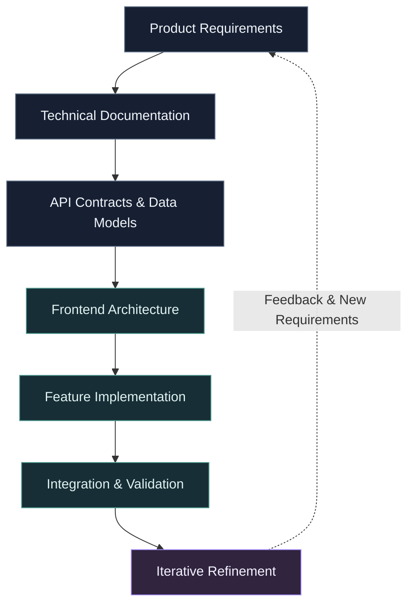
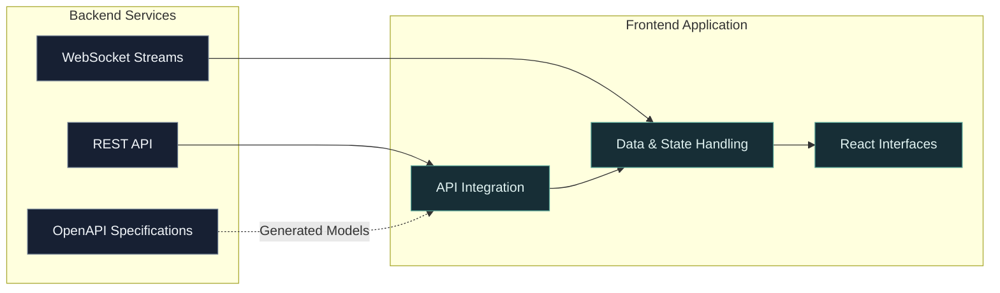

# Malih Asadi
### Frontend Engineer · React & TypeScript

**Engineering interfaces for evolving products.**

I work at the intersection of product requirements, backend contracts, and frontend architecture. My focus is building React applications that remain understandable, adaptable, and maintainable as product complexity grows.

Currently developing a **Fuzzer Orchestrator** from the ground up, translating technical documentation and evolving requirements into incremental frontend capabilities, from initial implementation toward an MVP.

[LinkedIn](https://www.linkedin.com/in/malih-asadi-a151b0289/) · [Email](mailto:maliheasadi99@gmail.com)

---

## 01 / Engineering Perspective

I approach frontend development as a system-design problem, not just a UI implementation task.

A feature rarely exists in isolation. It depends on product decisions, API contracts, application state, data flow, and the constraints of the surrounding system.

My work focuses on making those relationships explicit, so changes can be implemented without creating unnecessary coupling across the application.

My working model: understand the system, define the boundaries, implement incrementally, and refine based on feedback.

---

## 02 / Selected Engineering Experience

### Fuzzer Orchestrator
**Frontend Engineering · React · TypeScript**

Developing the frontend of a product from the ground up, based on technical documentation, backend APIs, and evolving product requirements.

- Break down product requirements into implementation phases and MVP milestones.
- Integrate REST APIs and work with WebSocket-based information streams.
- Build interfaces around complex jobs, system information, and multiple application states.
- Apply modular and layered structures to improve reuse and limit the impact of changes.
- Integrate OpenAPI-generated models to align frontend data contracts with backend specifications.
- Refactor application logic and state handling as technical requirements evolve.
- Collaborate with backend engineers and the Product Owner throughout feature development.

#### Frontend / Backend Interaction

Conceptual integration view based on the technologies and responsibilities described in my experience; not a complete production architecture diagram.

### Digital Menu
**Frontend Development · JavaScript · Vite**

Developed a web-based digital menu for cafe and restaurant management from scratch, working from product requirements and available APIs rather than predefined UI/UX designs.

- Defined the required interface layouts and user flows during development.
- Implemented product categorization and shopping cart functionality.
- Developed automatic order-total calculations and integrated REST APIs.
- Built the production output and deployed the application on Windows Server using IIS 10.

---

## 03 / Technical Toolkit

| Area | Technologies |
|---|---|
| Languages | JavaScript (ES6+), TypeScript, HTML5, CSS3, Sass |
| Framework & Build | React, Vite |
| UI Development | Tailwind CSS, Radix UI, shadcn/ui, Lucide Icons |
| State & Server Data | Zustand, React Query |
| API & Communication | REST APIs, WebSocket, OpenAPI, Swagger |
| Visualization | React Flow |
| Architecture | Layered Architecture, Modular Design, Atomic Design, OOP |
| Deployment | Windows Server, IIS 10 |

---

## 04 / Engineering Principles

**Explicit boundaries**

Keep responsibilities separated so that changes in one part of the application have a limited impact elsewhere.

**Contract-driven integration**

Understand API specifications and data models before building dependent UI behavior.

**Incremental delivery**

Translate evolving requirements into manageable features and deliver toward a usable MVP.

**Maintainability over unnecessary complexity**

Prefer clear, reusable structures and refactor when the needs of the product justify it.

**Technical communication**

Use documentation, clear requirements, and collaboration to make implementation decisions easier to understand and maintain.

---

## 05 / Current Direction

Continuously strengthening my frontend engineering foundations through practical work and technical study, with an emphasis on:

- JavaScript and TypeScript fundamentals
- React rendering, state management, and application behavior
- Frontend architecture and separation of concerns
- Debugging, testing, and code quality
- Performance analysis and maintainable implementation patterns

I value understanding why a solution works, what trade-offs it introduces, and how it will behave as the product evolves.

---

## Connect

Interested in frontend engineering, React and TypeScript, application architecture, and collaborative software development.

**[LinkedIn](https://www.linkedin.com/in/malih-asadi-a151b0289/)** · **[Email](mailto:maliheasadi99@gmail.com)**
